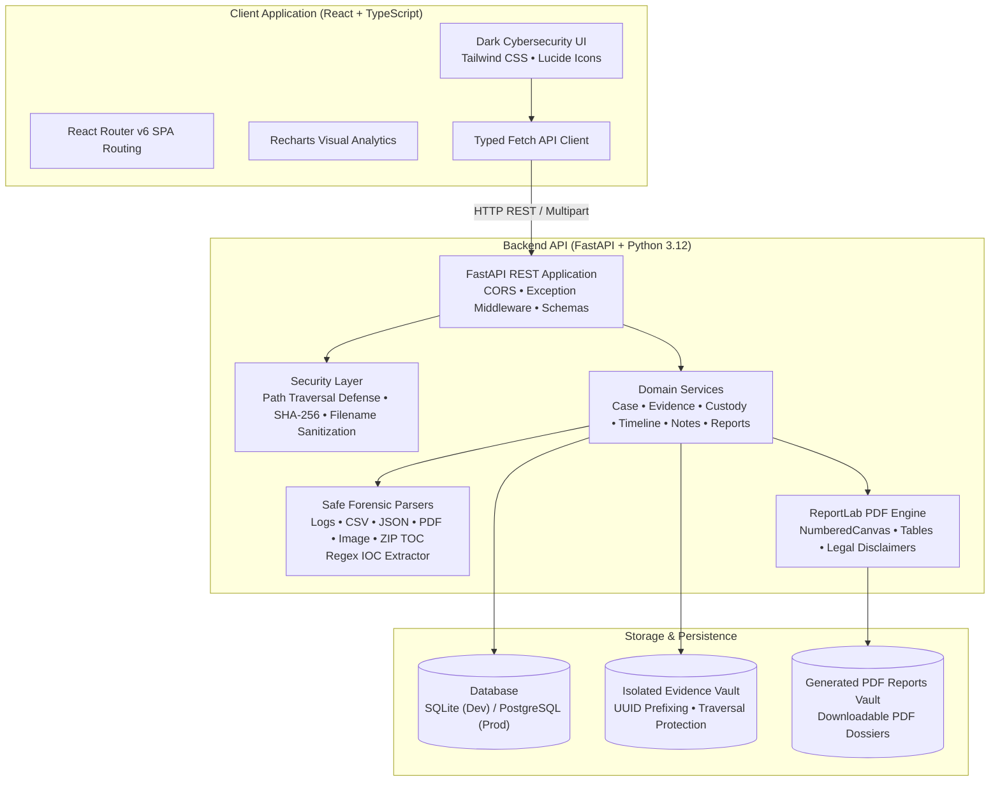

# DFIR CaseVault

<div align="center">


-emerald?style=for-the-badge&logo=pytest&logoColor=white)


### **Digital Evidence. Investigation. Integrity.**

*A digital forensics and incident response platform featuring case management, evidence tracking, cryptographic SHA-256 integrity verification, append-only chain-of-custody records, safe artifact analysis, multi-source timeline reconstruction, and PDF dossier generation.*

[Live Architecture](#system-architecture) • [Core Capabilities](#core-capabilities) • [Quickstart Guide](#quickstart-guide) • [Forensic Workflows](#forensic-workflows) • [Testing](#test-suite--quality-control) • [Deployment](#production-deployment)

</div>

---

## Portfolio Context

**DFIR CaseVault** is the third installment in my cybersecurity engineering portfolio series:

1. **[CyberNewsAI-Pro](https://github.com/utkarshchauhaniitk-star/CyberNewsAI-Pro)** &mdash; Cybersecurity Threat Intelligence & Automated Risk Summarization
2. **[ThreatForge](https://github.com/utkarshchauhaniitk-star/ThreatForge)** &mdash; Security Monitoring, SIEM Log Correlation & Threat Detection
3. **DFIR CaseVault** *(This Repository)* &mdash; Digital Forensics, Evidence Cryptography, Chain of Custody & Incident Response

Unlike generic SOC dashboards, **DFIR CaseVault** is tailored specifically for digital forensics investigators and incident responders. It enforces evidentiary discipline, cryptographic immutability, tamper detection, and audit reporting.

---

## Core Capabilities

- **Case Management & Dossiers**: Track incident investigations across classifications (Ransomware, Phishing, Data Exfiltration, Unauthorized Access, Insider Threat) with priority tiering, assigned investigators, and unified investigation workspaces.
- **Evidence Vault**: Secure multi-format artifact ingestion (LOG, CSV, JSON, TXT, PDF, PNG, JPG, ZIP). Files are isolated with collision-resistant UUID prefixes and protected against directory traversal attacks.
- **Genuine SHA-256 Cryptographic Verification**: Computes streaming 256-bit SHA-256 hashes upon ingest using Python `hashlib`. On-demand integrity verification detects byte-level modifications and flags `Integrity Mismatch` without overwriting the recorded baseline.
- **Append-Only Chain of Custody (CoC)**: Immutable evidentiary ledger recording every ingest, transfer, integrity audit, artifact analysis, and download with UTC timestamps, actor attribution, and corresponding hashes.
- **Non-Executing Forensic Artifact Analysis**:
  - Safe parsers for system logs, structured CSVs, hierarchical JSON, PDF metadata (`pypdf`), and image EXIF (`Pillow`).
  - Table-of-contents cataloging for ZIP archives without disk decompression, preventing zip-slip vulnerabilities.
- **Indicators of Compromise (IOC) Extraction**: Deterministic regex extraction of IPv4 addresses, domains, URLs, email addresses, and SHA-256 hashes with sanity validation (octet boundary checks, code extension filtering).
- **Chronological Timeline Reconstruction**: Multi-source timeline aggregating case milestones, evidence acquisitions, integrity audits, custody transfers, and investigator notes.
- **Forensic PDF Dossier Generation**: Compiles publication-ready PDF reports via **ReportLab**, featuring running headers, dynamic `NumberedCanvas` page counts, formatted tables, hashes, and chain-of-custody ledgers.
- **Dark Forensic UI**: Clean, responsive interface built with React, Vite, TypeScript, and Tailwind CSS.

---

## System Architecture



---

## Repository Structure

```
dfir-casevault/
├── backend/
│   ├── app/
│   │   ├── analyzers/        # Log, CSV, JSON, PDF, Image, ZIP TOC parsers & IOC regex
│   │   ├── api/              # FastAPI REST routers (cases, evidence, custody, reports...)
│   │   ├── core/             # Configuration, security guards, hashing, safe paths
│   │   ├── database/         # SQLAlchemy session, engine, and base setup
│   │   ├── models/           # Database models (Case, Evidence, CustodyEvent, Report...)
│   │   ├── reports/          # ReportLab PDF report generation engine
│   │   ├── schemas/          # Pydantic v2 validation models
│   │   ├── services/         # Business logic layer
│   │   └── main.py           # FastAPI entrypoint & middleware configuration
│   ├── tests/                # Pytest comprehensive test suite
│   ├── requirements.txt      # Python dependencies
│   ├── seed.py               # Database initialization & synthetic demo seeder
│   └── .env.example          # Backend environment template
├── frontend/
│   ├── src/
│   │   ├── components/       # Badges, modals, cards, sidebar, navbar
│   │   ├── layouts/          # Root layout shell
│   │   ├── pages/            # Dashboard, Cases, CaseDetail, Evidence, Timeline, Reports
│   │   ├── services/         # Typed REST client
│   │   ├── types/            # TypeScript data contracts
│   │   ├── App.tsx           # Route declarations
│   │   └── main.tsx          # React application root
│   ├── package.json          # Node dependencies & scripts
│   ├── vite.config.ts        # Vite configuration & proxy
│   ├── tailwind.config.js    # Tailwind styling config
│   └── vercel.json           # Vercel SPA rewrite rule
├── sample-data/
│   └── evidence/             # Synthetic logs, CSVs, configs, and phishing lures
├── docs/
│   ├── ARCHITECTURE.md       # Detailed technical design document
│   ├── API_DOCUMENTATION.md  # Complete REST API specification
│   └── DEPLOYMENT_GUIDE.md   # Production deployment manual (Render + Vercel)
├── .gitignore                # Excludes DB, evidence, venv, node_modules
├── render.yaml               # Render Cloud Blueprint
├── LICENSE                   # MIT License
└── README.md
```

---

## Quickstart Guide

### Prerequisites
- **Python**: `>= 3.10` (Python 3.12 recommended)
- **Node.js**: `>= 18.0` (v20 / v24 tested)
- **Git**

### 1. Clone the Repository
```bash
git clone https://github.com/utkarshchauhaniitk-star/dfir-casevault.git
cd dfir-casevault
```

### 2. Backend Setup
```bash
# Create virtual environment
python3 -m venv backend/.venv
source backend/.venv/bin/activate

# Install dependencies
pip install -r backend/requirements.txt

# Copy environment configuration
cp backend/.env.example backend/.env

# Initialize database and seed synthetic forensic cases
PYTHONPATH=backend python backend/seed.py --reset

# Start FastAPI development server
PYTHONPATH=backend uvicorn app.main:app --host 127.0.0.1 --port 8000 --reload
```
The backend API and interactive documentation will be available at:
- API Root: `http://127.0.0.1:8000`
- Swagger UI: `http://127.0.0.1:8000/docs`
- Health Endpoint: `http://127.0.0.1:8000/api/health`

### 3. Frontend Setup
In a new terminal window:
```bash
cd frontend

# Install dependencies
npm install

# Start Vite development server
npm run dev
```
Open **`http://localhost:5173`** in your browser.

---

## Synthetic Forensic Datasets

The platform includes synthetic forensic datasets:
1. **`auth_failures.log`**: Syslog entries illustrating an SSH brute-force attack and a reverse curl dropper staging `stage2.bin`.
2. **`c2_beacon_config.json`**: De-obfuscated malware configuration file specifying primary C2 host, beacon sleep intervals, and exfiltration targets.
3. **`phishing_email_headers.txt`**: Targeted spear-phishing email headers impersonating corporate IT security to harvest executive credentials.
4. **`exfil_network_traffic.csv`**: Flow logs showing anomalous outbound high-volume TCP egress during non-business hours.

To reseed at any time:
```bash
PYTHONPATH=backend python backend/seed.py --reset
```

---

## Test Suite & Quality Control

The project includes an automated test suite executed via `pytest`:

```bash
PYTHONPATH=backend backend/.venv/bin/pytest backend/tests -v
```

### Verification Results
```
backend/tests/test_api.py::test_health_check PASSED                      [ 12%]
backend/tests/test_api.py::test_dashboard_stats_empty_or_valid PASSED    [ 25%]
backend/tests/test_api.py::test_case_lifecycle PASSED                    [ 37%]
backend/tests/test_api.py::test_evidence_ingest_and_integrity_verification PASSED [ 50%]
backend/tests/test_api.py::test_missing_evidence_file_handling PASSED    [ 62%]
backend/tests/test_api.py::test_forensic_artifact_analysis_and_iocs PASSED [ 75%]
backend/tests/test_api.py::test_investigation_notes_and_timeline PASSED  [ 87%]
backend/tests/test_api.py::test_pdf_report_generation PASSED             [100%]

========================= 8 passed in 0.12s =========================
```

### Frontend Production Build
```bash
cd frontend
npm run build
```
Builds production-minified bundles with chunk splitting in under 1.5 seconds.

---

## Production Deployment

### Backend (Render)
1. Fork or push this repository to your GitHub account.
2. In Render, select **New > Blueprint** and select `render.yaml`.
3. Render will provision:
   - Python 3.12 Web Service (`uvicorn app.main:app`)
   - Managed PostgreSQL instance
   - 10GB persistent disk mounted for evidence isolation

### Frontend (Vercel)
1. In Vercel, import the repository and select the `frontend` root directory.
2. Set Environment Variable: `VITE_API_BASE_URL=https://<your-render-backend-url>`.
3. Deploy. Client-side routing is handled via `frontend/vercel.json`.

Detailed instructions are available in [DEPLOYMENT_GUIDE.md](docs/DEPLOYMENT_GUIDE.md).

---

## Security & Forensic Disclosures

- **Zero Arbitrary Execution**: Ingested artifacts are strictly treated as data; scripts or binaries are never executed.
- **Path Traversal Defense**: All file paths are strictly resolved and validated using `Path.is_relative_to()` to guarantee that artifacts remain inside the designated storage folder.
- **Safe ZIP Inspection**: Archive files are inspected via in-memory table-of-contents without unzipping to disk, preventing zip-slip vulnerabilities.
- **No Hardcoded Secrets**: Secrets and configurations are loaded via environment variables (`.env`).
- **Demonstration Advisory**: DFIR CaseVault is built for educational and portfolio demonstration purposes. It does not replace court-certified forensic software (e.g. EnCase, FTK) for judicial legal admissibility without independent audit validation.

---

## Author & Acknowledgements

**Utkarsh Chauhan**  
- GitHub: [@utkarshchauhaniitk-star](https://github.com/utkarshchauhaniitk-star)  
- Portfolio Projects: [CyberNewsAI-Pro](https://github.com/utkarshchauhaniitk-star/CyberNewsAI-Pro) • [ThreatForge](https://github.com/utkarshchauhaniitk-star/ThreatForge) • [DFIR CaseVault](https://github.com/utkarshchauhaniitk-star/dfir-casevault)

---

## License

This project is licensed under the [MIT License](LICENSE).
