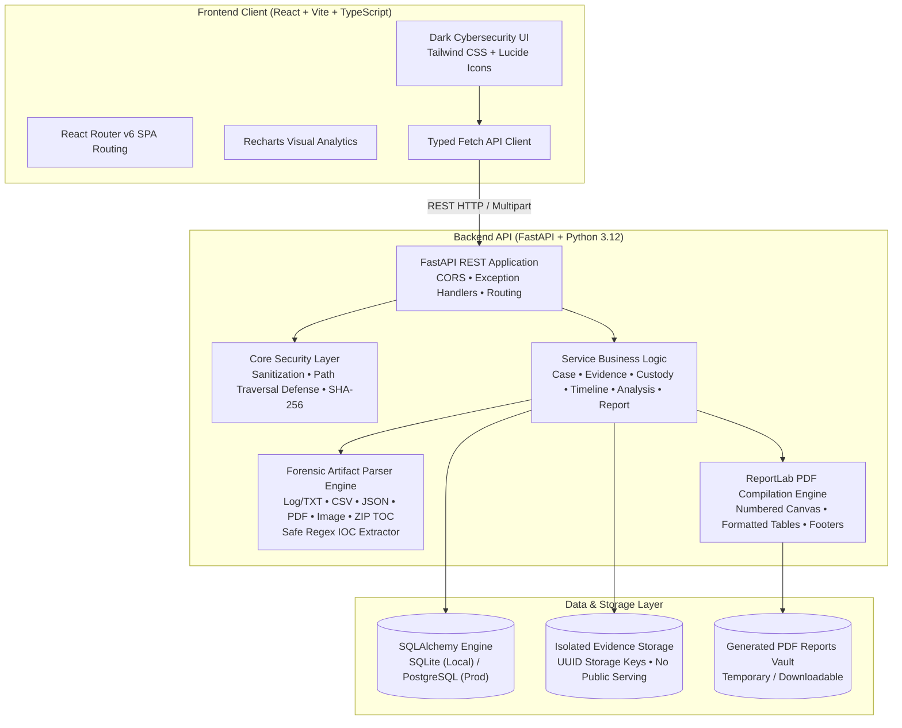

# DFIR CaseVault &mdash; System Architecture & Forensic Design

## 1. Architectural Philosophy
DFIR CaseVault is built to provide an incident management and forensic evidence tracking platform emphasizing cryptographic evidence integrity, tamper detection, and structured incident investigation.

## 2. Core Forensic Workflows

### 2.1 Cryptographic SHA-256 Ingestion & Verification
1. **Evidence Ingestion**: When an investigator uploads an artifact, the server streams the byte content, enforces the 25 MB ceiling, computes a baseline SHA-256 hash using Python `hashlib`, saves the file with an unguessable UUID-prefixed filename in an isolated storage directory, creates a database record with status `Unverified`, and commits an immutable `Evidence Ingested` custody ledger entry.
2. **Integrity Verification**: When "Verify Hash" is executed, the server re-reads the stored file directly from disk, computes its current streaming SHA-256 digest, and compares it with the immutable baseline recorded at ingest.
   - **Match**: Status is marked `Verified`, logged in `integrity_verifications` table and custody ledger.
   - **Discrepancy**: Status is marked `Integrity Mismatch` with an alert. **The original recorded hash is never overwritten**, preventing evidence tampering from overwriting the historical record.
   - **Missing File**: Status is marked `File Missing`.

### 2.2 Append-Only Chain of Custody
Every evidentiary action (ingestion, transfer, verification, download, analysis) commits a non-destructive audit record to `custody_events`. Ordinary users cannot edit or delete custody entries through the API.

### 2.3 Non-Executing Forensic Artifact Analysis
The artifact analysis engine extracts metadata and Indicators of Compromise (IOCs) without executing code:
- **LOG/TXT**: Line counting, timestamp parsing, regex pattern extraction.
- **CSV**: Header structure, row counting, field inspection.
- **JSON**: Key hierarchy and array record analysis.
- **PDF**: Page counts, document metadata (`pypdf`).
- **Images**: Dimensions, format, EXIF tags (`Pillow`).
- **ZIP**: Table-of-contents cataloging (`zipfile`), inspecting internal filenames for path traversal markers (`../`) without decompressing to disk.

### 2.4 Indicators of Compromise (IOC) Extraction
Extracts IPv4, Domain, URL, Email, and SHA-256 candidates using strict regex patterns with validation:
- Validates IP octets (0-255) using Python `ipaddress`.
- Discards code extensions (`.py`, `.ts`, `.log`, `.csv`) from false domain classifications.
- Flags indicators as `Extracted`, `Unverified`, or `Needs Review`.
- Never makes outbound HTTP or DNS requests to extracted indicators.

### 2.5 PDF Forensic Dossier Generation (ReportLab)
Generates audit-ready multi-page investigation reports featuring:
- Case overview, incident narrative, classification.
- Evidence inventory with file sizes, collection sources, and full SHA-256 hashes.
- Chain of custody chronological transfer ledger.
- Incident reconstruction timeline.
- Investigator triage notes.
- Running header, running footer with "Page X of Y" via custom `NumberedCanvas`, and portfolio demonstration disclosures.
